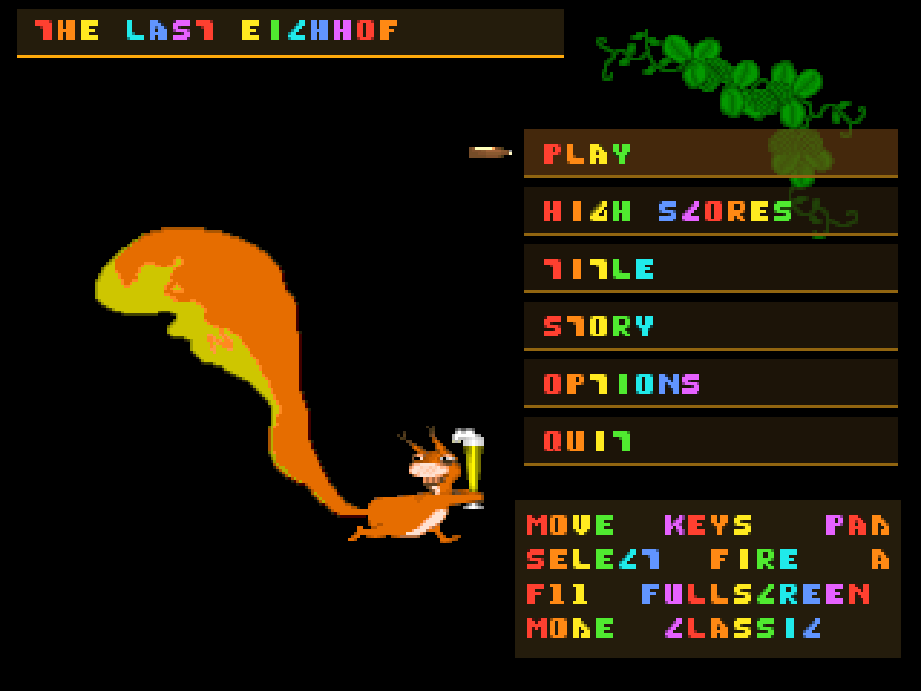
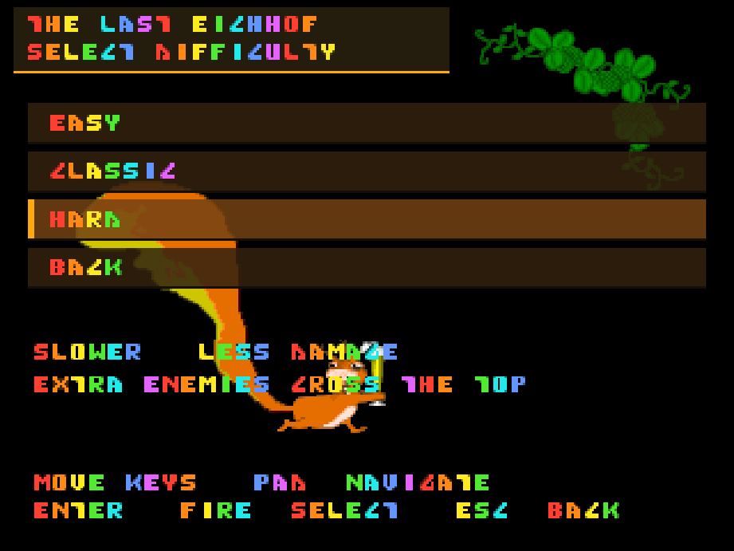
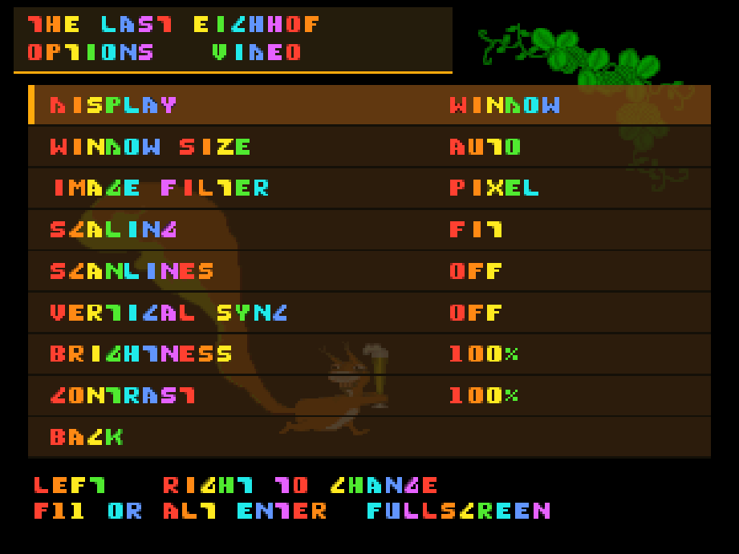
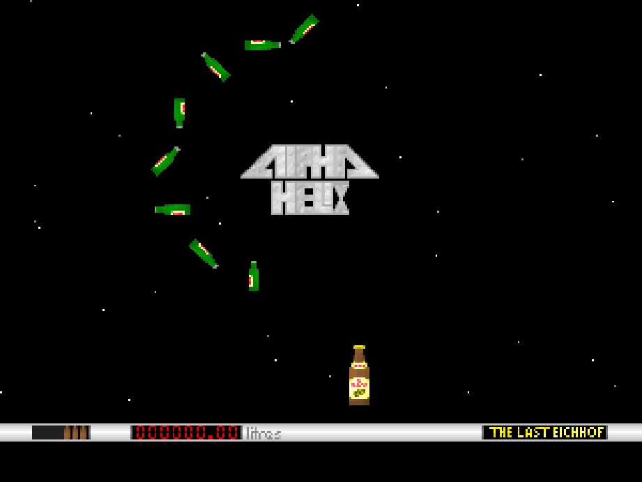

# The Last Eichhof — SDL3

A modernized port of Alpha-Helix's wonderfully strange 1993 beer-themed arcade shooter. Fly the Eichhof bottle through waves of hostile drinks, buy weapons between levels, and try to make the high-score table.

This fork builds on [kilobyte/lastbeer](https://github.com/kilobyte/lastbeer), Gavin Smith's Allegro port, and keeps the original game's art, sounds and gameplay at its heart. The SDL3 version is a work in progress; it has not yet been fully played through or compared with the original game.



## What's new

- **One resizable window** throughout the game, with fullscreen and a consistent 4:3 game view.
- **Keyboard and gamepad support**, including controller selection, remappable controls and menu navigation.
- **Video settings** for display size, pixel/linear/Scale2x filters, scaling, scanlines, vertical sync, brightness and contrast.
- **Easy, Classic and Hard** selectable when starting a game, with separate high-score tables for each difficulty.
- **A refreshed menu** with the original artwork, an animated pointer, and selectable classic, bold or title-style fonts with white or rainbow text.
- **SDL3 audio and screenshots**, plus fixes for projectile cleanup and high-score entry.

Classic uses the existing movement and damage rules. Easy increases movement speed and weapon damage; Hard slows movement, reduces weapon damage and occasionally adds an enemy crossing the top of the screen. The selection stays fixed for the whole run.

| Choose your challenge | Tune the display |
| --- | --- |
|  |  |



## Download and play

Successful [package builds](https://github.com/kintera/lastbeer-sdl/actions/workflows/build-packages.yml) provide x86-64 Windows ZIP and Linux AppImage artifacts. Select a completed workflow run to download its artifacts.

- **Windows:** Extract the ZIP and run `beer-sdl.exe` from the extracted `LastEichhof` folder. Keep `SDL3.dll` and `BEER.DAT` next to the executable.
- **Linux:** Make the AppImage executable (`chmod +x LastEichhof-x86_64.AppImage`) and run it. It includes SDL3 and the game data. AppImage compatibility depends on the Linux distribution and the build system's library baseline.

## Build and run

Requirements: SDL3 development files, CMake 3.16 or newer, and C and C++20 compilers. From a checkout:

```sh
cmake -S . -B build-sdl -DCMAKE_BUILD_TYPE=Release
cmake --build build-sdl
ctest --test-dir build-sdl --output-on-failure
./build-sdl/beer-sdl
```

The game looks for `BEER.DAT` next to the executable, then in the configured data directory or current directory. Run `beer-sdl --no-sound` to bypass audio initialization. See [MODERNIZATION.md](MODERNIZATION.md) for detailed settings, build notes and the status of the port.

## Controls

| Action | Keyboard | Controller |
| --- | --- | --- |
| Move / navigate | Arrow keys | D-pad or left stick |
| Fire / select | Space or Enter | Bottom face button (A / Cross) |
| Back / leave level | Escape | Right face button (B / Circle) |
| Pause | P | Start |
| Toggle fullscreen | F11 or Alt+Enter | — |
| Save screenshot | Alt+S | — |

Keyboard and controller bindings can be changed in Options. Typing a custom high-score name requires a keyboard; a controller can accept the default name.

## Credits and license

The original game and data are by Alpha-Helix. The original MS-DOS source was released by Dany Schoch with this notice:

> Do what ever you want with this code. Use it in your code, change it, delete it. HOWEVER: Don't blame me if it doesn't work the way it should.

The game data is copyrighted by its original authors and was described as freely distributable under the same license. The Allegro port is copyright 2014 Gavin Smith and licensed under the GNU GPL version 3; see [LICENSE.GPL](LICENSE.GPL). SDL3 is distributed under its [zlib license](packaging/SDL3-LICENSE.txt).
